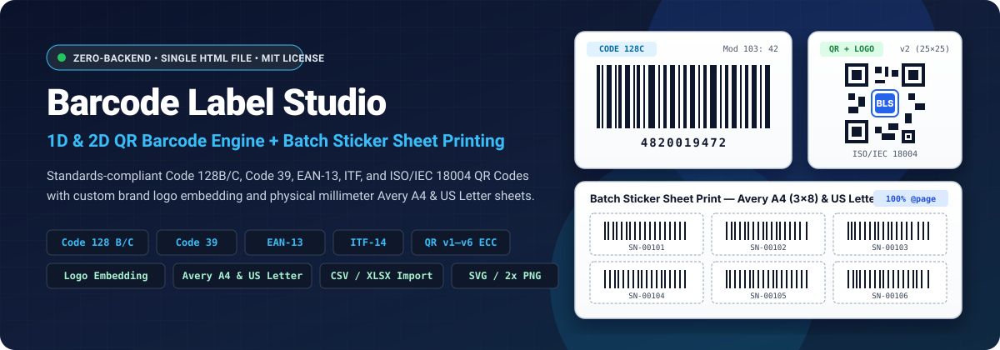
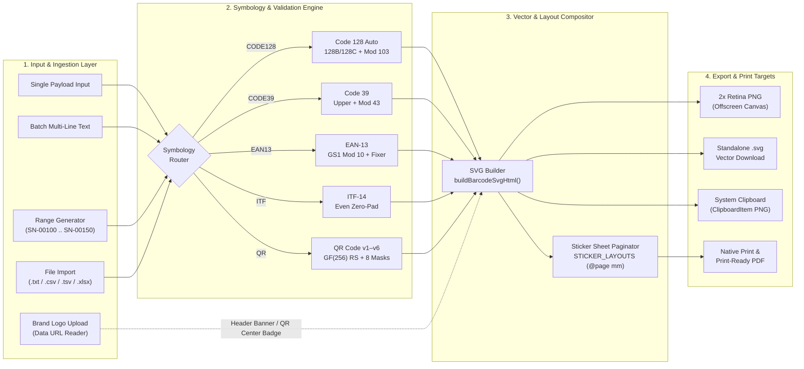
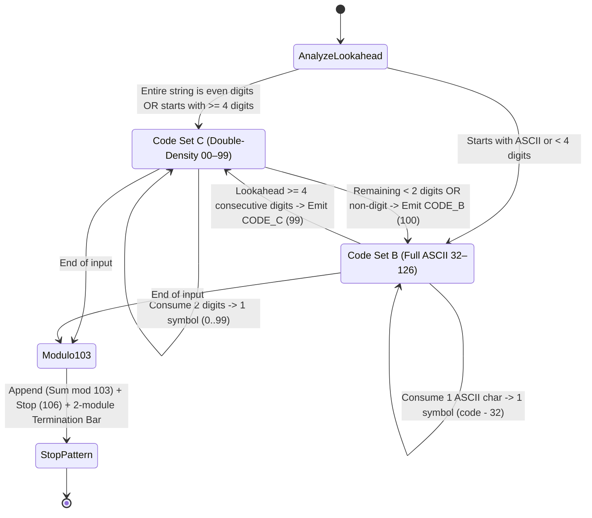
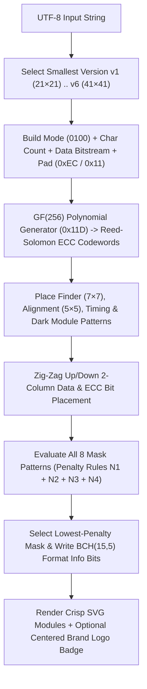
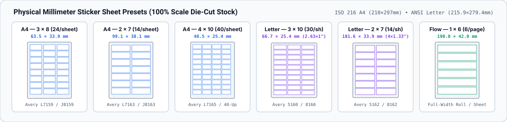

<div align="center">

<a href="https://rajwanyair.github.io/barcode-label-studio/">
  
</a>

<br />

[](https://rajwanyair.github.io/barcode-label-studio/)
[](https://github.com/RajwanYair/barcode-label-studio/actions)
[](https://github.com/RajwanYair/barcode-label-studio/releases)
[-7c3aed?style=for-the-badge)](index.html)
[](LICENSE)

<p align="center">
  <strong><a href="https://rajwanyair.github.io/barcode-label-studio/">🚀 Launch Live Web App (GitHub Pages)</a></strong>
  ·
  <a href="https://raw.githack.com/RajwanYair/barcode-label-studio/main/index.html">🌐 Global CDN Mirror (githack)</a>
  ·
  <a href="https://github.com/RajwanYair/barcode-label-studio/releases/latest">📦 Download Single-File Release</a>
  ·
  <a href="https://github.com/RajwanYair/barcode-label-studio/issues">🐛 Report Bug / Request Feature</a>
</p>

</div>

---

## 📖 Overview

**Barcode Label Studio** is an industrial-grade, zero-backend **1D & 2D QR barcode workbench and batch die-cut sticker sheet printing studio** packaged entirely inside a single, self-contained [`index.html`](index.html) file.

Every encoder—**Code 128 Auto (`128B`/`128C`)**, **Code 39**, **EAN-13**, **ITF (Interleaved 2 of 5)**, and **QR Code (ISO/IEC 18004 Model 2 with GF(256) Reed-Solomon ECC)**—is implemented in pure, dependency-free JavaScript and rendered to crisp vector `<svg>` graphics with physical millimeter (`mm`) `@page` print stylesheets.

---

## 🌐 Access as a Running Web Page from Anywhere

Because the entire application lives in a single static [`index.html`](index.html) with **zero external runtime dependencies**, you can run it immediately from any browser on desktop, tablet, or mobile:

| Access Channel | Live URL / Command | Best For |
| :--- | :--- | :--- |
| **1. Official GitHub Pages** | **[`https://rajwanyair.github.io/barcode-label-studio/`](https://rajwanyair.github.io/barcode-label-studio/)** | Primary production web app (HTTPS, fast global edge caching) |
| **2. Raw GitHack CDN Mirror** | **[`https://raw.githack.com/RajwanYair/barcode-label-studio/main/index.html`](https://raw.githack.com/RajwanYair/barcode-label-studio/main/index.html)** | Instant fallback mirror served via Cloudflare CDN |
| **3. HTMLPreview Mirror** | **[`https://htmlpreview.github.io/?https://github.com/RajwanYair/barcode-label-studio/blob/main/index.html`](https://htmlpreview.github.io/?https://github.com/RajwanYair/barcode-label-studio/blob/main/index.html)** | Direct preview of the latest `main` branch HTML |
| **4. Air-Gapped / Offline File** | `curl -fsSL https://raw.githubusercontent.com/RajwanYair/barcode-label-studio/main/index.html -o barcode-label-studio.html` | Warehouse, lab, or factory floor machines with no internet |

---

## ✨ Why Barcode Label Studio?

| Capability | **Barcode Label Studio** | Typical Web Generators | Desktop Label Suites |
| :--- | :---: | :---: | :---: |
| **100% Client-Side Privacy (Zero Telemetry)** | ✅ Yes | ❌ Uploads serials to server | ✅ Yes |
| **Single-File Offline Portability (`index.html`)** | ✅ 1 file (~80 KB) | ❌ Requires backend | ❌ 500 MB+ installer |
| **Code 128 Auto (`128B` ↔ `128C` Digit Compaction)** | ✅ Dynamic lookahead | ⚠️ Usually 128B only | ✅ Yes |
| **EAN-13 Check-Digit Validation & 1-Click Repair** | ✅ Built-in GS1 fixer | ❌ Rejects with generic error | ⚠️ Manual |
| **QR Code ISO/IEC 18004 + Custom Logo Overlay** | ✅ Vector SVG + badge | 💰 Paid tier / watermarked | ✅ Yes |
| **Physical Avery A4 & US Letter `@page` Grids** | ✅ Exact `mm` geometry | ❌ Single image download only | ✅ Yes |
| **Batch CSV / TSV / Excel (`.xlsx`/`.xls`) Import** | ✅ Drag-and-drop parser | ❌ Manual 1-by-1 entry | ✅ Yes |
| **Bilingual UI (English LTR & Hebrew `עברית` RTL)** | ✅ Instant 1-click toggle | ❌ English only | ⚠️ OS-locked |
| **Dark / Light Mode + PC, Tablet & Mobile Layout** | ✅ Adaptive & optical-safe | ⚠️ Fixed desktop layout | ❌ Desktop only |
| **Automated Unit Test Suite (`node:test`)** | ✅ 28 deterministic tests | ❌ None | ❌ Proprietary |

---

## 🏗️ System Architecture & Data Flow

<div align="center">
  
</div>

### End-to-End Reactive Data Flow (Mermaid)



---

## 🔬 Symbology Specifications & Encoding Algorithms

| Symbology | Standard | Character Set | Checksum / Error Correction | Smart Optimization & Diagnostics | Typical Applications |
| :--- | :--- | :--- | :--- | :--- | :--- |
| **Code 128 Auto** | ISO/IEC 15417 | Full ASCII (`0x20–0x7E`) | **Modulo 103** weighted symbol sum | Dynamic lookahead switches to **Code Set C** (2 digits/symbol) for $\ge 4$ consecutive even digits or entire even numeric strings; **Code Set B** for ASCII | Logistics, GS1-128 serials, asset tags, warehouse bins |
| **Code 39** | ISO/IEC 16388 | `0–9`, `A–Z`, space, `- . $ / + %` | **Modulo 43** telemetry check character | Auto-normalizes lowercase input to uppercase; offers 1-click switch to Code 128 for unsupported ASCII symbols | Automotive, defense (LOGMARS), industrial badge IDs |
| **EAN-13** | GS1 General Spec | 12 or 13 numeric digits (`0–9`) | **GS1 Modulo 10** ($3\times / 1\times$ alternating weights) | Automatically computes 13th digit from 12 digits; detects wrong 13th check digit and provides a **1-click Fix button** (`fixValue`) | Retail point-of-sale (POS), books (ISBN-13), consumer goods |
| **ITF (2 of 5)** | ISO/IEC 16390 | Numeric digits (`0–9`) | Pairwise interleaved bar/space width parity | Automatically prepends a leading `0` when given an odd number of digits (`ITF (0-padded)`) | Corrugated cartons, master shipping cases, pallets |
| **QR Code** | ISO/IEC 18004 | Full UTF-8 byte stream (up to 134 B) | **Reed-Solomon ECC Level L** over $\text{GF}(2^8)$ | Auto-selects **Version 1 ($21\times21$) to Version 6 ($41\times41$)**; evaluates all 8 masks using the 4 ISO penalty rules | URLs, mobile scan workflows, vCards, branded product stickers |

### Code 128 Auto (`128B` ↔ `128C`) Compaction State Machine



### QR Code (ISO/IEC 18004) Matrix Construction Pipeline



---

## 🖨️ Standard Die-Cut Sticker Sheet Presets (`@page` Millimeter Accuracy)

<div align="center">
  
</div>

All batch layouts use physical millimeter (`mm`) CSS Grid and `@page` rules so printed sheets align with physical die-cut label stock at **100% scale**:

| Preset Key | Paper Standard | Page Dimensions | Grid (`Cols × Rows`) | Labels / Sheet | Label Size (`mm`) | Label Size (`in`) | Page Margin (`Top/Bottom`, `Left/Right`) | Inter-Label Gap (`Row × Col`) | Compatible Avery / ISO Stock |
| :--- | :--- | :--- | :---: | :---: | :---: | :---: | :--- | :--- | :--- |
| `a4-3x8` | **ISO A4** | `210 × 297 mm` | `3 × 8` | **24** | `63.5 × 33.9 mm` | `2.50" × 1.33"` | `12.0 mm`, `7.0 mm` | `0 mm × 2.5 mm` | **Avery L7159**, J8159, Herma 4457 |
| `a4-2x7` | **ISO A4** | `210 × 297 mm` | `2 × 7` | **14** | `99.1 × 38.1 mm` | `3.90" × 1.50"` | `15.0 mm`, `4.6 mm` | `0 mm × 2.5 mm` | **Avery L7163**, J8163, Herma 4453 |
| `a4-4x10` | **ISO A4** | `210 × 297 mm` | `4 × 10` | **40** | `48.5 × 25.4 mm` | `1.91" × 1.00"` | `21.5 mm`, `8.0 mm` | `0 mm × 0 mm` | **Avery L7165**, 40-up address/bin labels |
| `letter-3x10` | **US Letter** | `215.9 × 279.4 mm` | `3 × 10` | **30** | `66.7 × 25.4 mm` | `2.625" × 1.00"` | `12.7 mm`, `4.8 mm` | `0 mm × 3.2 mm` | **Avery 5160**, 8160, 5260, 8460 |
| `letter-2x7` | **US Letter** | `215.9 × 279.4 mm` | `2 × 7` | **14** | `101.6 × 33.9 mm` | `4.00" × 1.33"` | `21.1 mm`, `4.0 mm` | `0 mm × 4.6 mm` | **Avery 5162**, 8162, 5262 |
| `flow` | **Continuous / A4** | `210 × 297 mm` | `1 × 6` | **6 / page** | `190.0 × 42.0 mm` | `7.48" × 1.65"` | `10.0 mm`, `10.0 mm` | `4.0 mm × 0 mm` | Wide rack labels, shelf strips, roll printers |

---

## 🔢 Batch Input Sources & Range Generator Examples

In **Batch / Sticker Sheet Print** mode, you can populate hundreds of barcodes via three methods:

| Input Source | Supported Syntax / File Formats | Example Input | Generated Sequence |
| :--- | :--- | :--- | :--- |
| **1. Text List** | One barcode payload per line (empty lines ignored) | `ASSET-101`\n`ASSET-102` | `ASSET-101`, `ASSET-102` |
| **2. Number Range** | Pure numeric or prefixed zero-padded ranges (`parseNumericSuffix`) | From `SN-00100` to `SN-00105` | `SN-00100`, `SN-00101`, `SN-00102`, `SN-00103`, `SN-00104`, `SN-00105` |
| **3. File Import** | `.txt`, `.csv`, `.tsv`, `.xlsx`, `.xls` (auto-splits rows & columns) | Spreadsheet or CSV drop | Extracts all non-empty cells in row-major order |

---

## 🚀 Quick Start & Local Development

### 1. Run Locally (Zero Build Step)

Clone the repository and open [`index.html`](index.html) directly in any browser:

```bash
git clone https://github.com/RajwanYair/barcode-label-studio.git
cd barcode-label-studio

# Open directly via file://
xdg-open index.html   # Linux
open index.html       # macOS
```

Or serve over local HTTP:

```bash
python3 -m http.server 8080
# Visit http://localhost:8080
```

### 2. Run the Automated Unit Test Suite

The repository includes a 24-test zero-dependency suite in [`tests/barcode.test.js`](tests/barcode.test.js) powered by Node's built-in `node:test` and `node:vm` modules:

```bash
npm test
# or directly:
node --test tests/barcode.test.js
```

**What the test suite verifies:**
- **Repository & DOM Integrity**: Confirms all required documentation files exist and every DOM ID queried during initialization is present in [`index.html`](index.html).
- **Code 128 (`128B`/`128C`)**: Validates all 107 pattern entries, even-digit `128C` compaction, `128B` ASCII encoding, mixed `128B`↔`128C` transitions, and invalid character rejection.
- **Code 39**: Verifies uppercase normalization, start/stop patterns, Modulo 43 telemetry, and Code 128 fallback hints.
- **EAN-13**: Verifies GS1 check-digit calculation (`978020137962` → `4`), 95-module bit length, wrong check-digit detection (`fixValue`), and non-numeric rejection.
- **ITF**: Verifies even-length encoding and automatic leading-zero padding on odd-length numeric inputs.
- **QR Code (ISO/IEC 18004)**: Verifies Version 1 ($21\times21$) and Version 2+ scaling, $7\times7$ finder pattern rings, dark module placement, and empty-input handling.
- **Logo Embedding & XML Safety**: Verifies `<image>` injection for 1D header banners and QR center badges, plus strict XML entity escaping (`&amp;`, `&lt;`, `&gt;`).

---

## 📁 Project Structure

```text
barcode-label-studio/
├── index.html                           # Self-contained application (HTML5 + CSS3 + ES6 Barcode/QR/Print Engine)
├── assets/
│   ├── hero-banner.svg                  # Vector hero banner for documentation & social preview
│   ├── architecture-flow.svg            # 4-stage client-side architecture diagram
│   └── sticker-presets.svg              # Visual guide to Avery A4 & US Letter die-cut sheet layouts
├── tests/
│   └── barcode.test.js                  # 24 automated unit tests (node:test + node:vm)
├── .github/
│   ├── workflows/
│   │   └── ci.yml                       # GitHub Actions CI & GitHub Pages deployment workflow
│   ├── ISSUE_TEMPLATE/
│   │   ├── bug_report.md                # Structured bug report template
│   │   └── feature_request.md           # Symbology / preset feature request template
│   └── PULL_REQUEST_TEMPLATE.md         # PR checklist for encoders and @media print testing
├── package.json                         # Package metadata & npm test script
├── README.md                            # Comprehensive documentation, Mermaid flows & reference tables
├── CHANGELOG.md                         # Keep-a-Changelog release history
├── CONTRIBUTING.md                      # Contributor guide & engineering principles
├── CODE_OF_CONDUCT.md                   # Contributor Covenant Code of Conduct
├── SECURITY.md                          # Security policy & vulnerability reporting
└── LICENSE                              # MIT License
```

---

## 🤝 Contributing & License

Contributions, new barcode symbologies, and additional regional label sheet presets are welcome! Please read [CONTRIBUTING.md](CONTRIBUTING.md) and our [Code of Conduct](CODE_OF_CONDUCT.md) before submitting a pull request.

Released under the **[MIT License](LICENSE)**.

