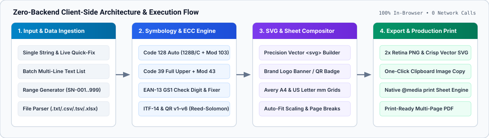
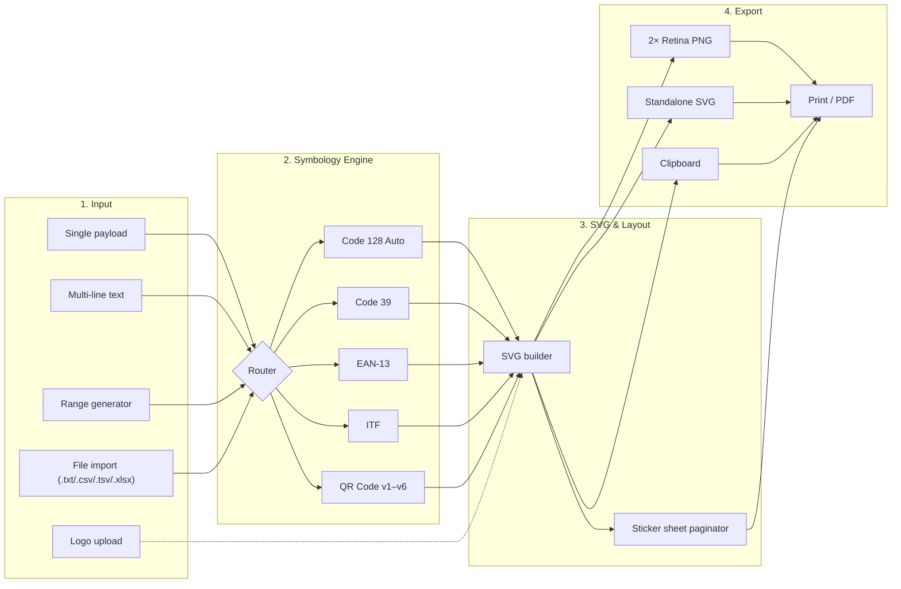

<div align="center">

<a href="https://rajwanyair.github.io/barcode-label-studio/">
  
</a>

<br />

[](https://rajwanyair.github.io/barcode-label-studio/)
[](https://github.com/RajwanYair/barcode-label-studio/actions)
[](https://github.com/RajwanYair/barcode-label-studio/releases)
[-7c3aed?style=for-the-badge)](index.html)
[](LICENSE)

<p align="center">
  <strong><a href="https://rajwanyair.github.io/barcode-label-studio/">🚀 Launch Live Web App</a></strong>
  ·
  <a href="SPEC.md">📐 Specification (SPEC.md)</a>
  ·
  <a href="ROADMAP.md">🗺️ Roadmap (ROADMAP.md)</a>
  ·
  <a href="https://github.com/RajwanYair/barcode-label-studio/releases/latest">📦 Download Latest Release</a>
  ·
  <a href="https://github.com/RajwanYair/barcode-label-studio/issues">🐛 Report Bug / Request Feature</a>
</p>

</div>

---

## 📖 Overview

**Barcode Label Studio** is a free, open-source (MIT), zero-backend barcode workbench and sticker-sheet printing studio. It ships as a single self-contained [index.html](index.html) file with no required runtime dependencies.

Supported symbologies:

| Symbology | Standard | Notes |
| :--- | :--- | :--- |
| 📊 Code 128 Auto | ISO/IEC 15417 | Dynamic 128B ↔ 128C compaction + Mod 103 checksum |
| 🏭 Code 39 | ISO/IEC 16388 | Upper + Mod 43 telemetry check |
| 🛒 EAN-13 | GS1 General Spec | GS1 Mod 10 check digit, auto-compute & repair |
| 📦 ITF / Interleaved 2 of 5 | ISO/IEC 16390 | Even zero-pad for odd-length input |
| 📱 QR Code | ISO/IEC 18004 | Versions 1–6, GF(256) Reed–Solomon ECC, optional logo badge |

All encoders render crisp vector SVG with physical `mm` `@page` print styles for die-cut sticker stock.

---

## 🌐 Access from Anywhere

| Channel | Link | Best For |
| :--- | :--- | :--- |
| GitHub Pages | [rajwanyair.github.io/barcode-label-studio](https://rajwanyair.github.io/barcode-label-studio/) | Primary HTTPS app with global edge caching |
| Raw GitHack CDN | [raw.githack.com/.../main/index.html](https://raw.githack.com/RajwanYair/barcode-label-studio/main/index.html) | Fallback mirror via Cloudflare |
| HTMLPreview | [htmlpreview.github.io/...](https://htmlpreview.github.io/?https://github.com/RajwanYair/barcode-label-studio/blob/main/index.html) | Preview latest `main` branch |
| Offline file | `curl -fsSL https://raw.githubusercontent.com/RajwanYair/barcode-label-studio/main/index.html -o barcode-label-studio.html` | Air-gapped workstations |

---

## ✨ Highlights

- 🔒 **100% client-side** — no uploads, no telemetry, no backend.
- 📦 **Single-file portability** — copy `index.html` and run anywhere.
- 🌍 **Bilingual** — English (LTR) and Hebrew (RTL) with LTR-isolated serial values.
- 🌓 **Light/Dark modes** — persists in `localStorage`, with scanner-safe white sticker surfaces.
- 📱 **Responsive** — desktop, tablet, and mobile layouts.
- 📂 **Batch import** — text lists, numeric ranges, CSV/TSV/Excel (`.xlsx`/`.xls`).
- 🖨️ **Physical print presets** — A4 and US Letter Avery-compatible die-cut sheets.
- 🧪 **Automated tests** — 35 tests across meta-guard, encoders, I18N, assets, and docs.

---

## 🏗️ Architecture & Data Flow

<div align="center">
  
</div>



---

## 🖨️ Sticker Sheet Presets

All presets use physical millimeter CSS Grid and `@page` rules for 100% scale printing:

| Key | Paper | Grid | Labels | Label Size (mm) | Compatible Avery / ISO |
| :--- | :--- | :---: | :---: | :--- | :--- |
| `a4-3x8` | A4 | 3 × 8 | 24 | 63.5 × 33.9 | L7159, J8159, Herma 4457 |
| `a4-2x7` | A4 | 2 × 7 | 14 | 99.1 × 38.1 | L7163, J8163, Herma 4453 |
| `a4-4x10` | A4 | 4 × 10 | 40 | 48.5 × 25.4 | L7165, 40-up address |
| `letter-3x10` | US Letter | 3 × 10 | 30 | 66.7 × 25.4 | 5160, 8160, 5260, 8460 |
| `letter-2x7` | US Letter | 2 × 7 | 14 | 101.6 × 33.9 | 5162, 8162, 5262 |
| `flow` | A4 / continuous | 1 × 6 | 6/page | 190.0 × 42.0 | Rack labels, shelf strips |

---

## 🚀 Quick Start

```bash
git clone https://github.com/RajwanYair/barcode-label-studio.git
cd barcode-label-studio
xdg-open index.html        # Linux
# open index.html          # macOS

# Or serve over HTTP:
python3 -m http.server 8080
# Visit http://localhost:8080
```

Run tests:

```bash
npm test
# or: node --test tests/barcode.test.js
```

The suite includes 35 tests that verify every function export, I18N key, SVG asset, doc link, encoder, and UI helper.

---

## 🛤️ Roadmap

Upcoming work is tracked in [ROADMAP.md](ROADMAP.md): UPC-A/EAN-8/Codabar, QR ECC levels, DataMatrix, custom sheet builder, camera scan verifier, PWA offline support, and ZPL/ESC-POS thermal printer export.

---

## 📁 Repository Layout

```text
barcode-label-studio/
├── index.html                           # Self-contained production app
├── SPEC.md                              # Technical specification
├── ROADMAP.md                           # Sprint roadmap & issues backlog
├── README.md                            # This file
├── CHANGELOG.md                         # Release history
├── CONTRIBUTING.md                      # Contributor guide
├── SECURITY.md                          # Security policy
├── CODE_OF_CONDUCT.md                   # Code of conduct
├── LICENSE                              # MIT License
├── package.json                         # npm metadata, scripts & engines
├── tests/barcode.test.js                # Automated test & Meta-Guard suite
├── .vscode/                             # VS Code settings, tasks, launch & extensions
├── .github/copilot-instructions.md      # GitHub Copilot Chat workspace rules
├── .github/prompts/                     # Reusable Copilot Chat prompt workflows
├── .github/workflows/ci.yml             # GitHub Actions CI (Node 20 & 22 matrix)
├── .github/workflows/release.yml        # Automated GitHub Release asset publisher
├── .github/dependabot.yml               # Weekly GitHub Actions dependency updates
├── .github/ISSUE_TEMPLATE/              # Issue templates & chooser config
├── .github/PULL_REQUEST_TEMPLATE.md     # Pull request checklist
└── assets/                              # SVG diagrams
```

---

## 🤝 Contributing & License

Contributions are welcome! Please read [CONTRIBUTING.md](CONTRIBUTING.md) and [CODE_OF_CONDUCT.md](CODE_OF_CONDUCT.md) before submitting issues or pull requests.

Released under the [MIT License](LICENSE).
