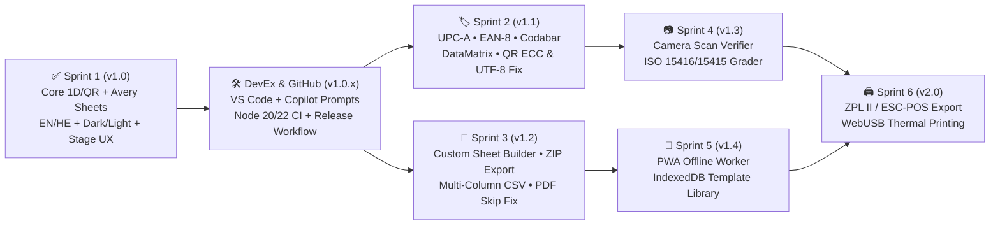
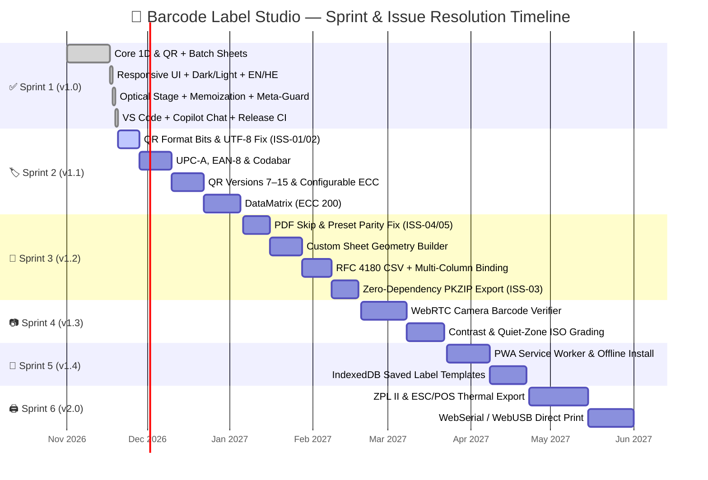

# 🗺️ Barcode Label Studio — Engineering Roadmap (`ROADMAP.md`)

 

[-059669?style=for-the-badge)](CHANGELOG.md)

---

## 🎯 Overview

This roadmap turns [SPEC.md](SPEC.md) into testable engineering sprints, tracks active technical issues to solve, and documents workspace/CI automation. Every sprint task and repository integration rule is enforced by [tests/barcode.test.js](tests/barcode.test.js).

---

## 📡 GitHub Release & CI/CD Workflow Status (`2026-11-19`)

| Integration Area | Current State | Details & Verification |
| :--- | :---: | :--- |
| **Latest GitHub Release** | ✅ `v1.0.0` | Published `2026-11-18T08:47:21Z` ([Release v1.0.0](https://github.com/RajwanYair/barcode-label-studio/releases/tag/v1.0.0)); annotated tag `v1.0.0` → `d3c60c9`, release `targetCommitish` → `d98b204`. |
| **CI Test Workflow** | ✅ Passing | [.github/workflows/ci.yml](.github/workflows/ci.yml) — latest run `#44290313440` on `main` (`d3c60c9`) succeeded in `17s`. Upgraded to Node.js `20` & `22` matrix with step summaries. |
| **GitHub Pages Deployment** | ✅ Live | `pages-build-deployment` run `#44290313847` on `main` (`d3c60c9`) succeeded in `25s`; live at [rajwanyair.github.io/barcode-label-studio](https://rajwanyair.github.io/barcode-label-studio/) with HTTPS enforced. |
| **Release Asset Packaging** | ✅ Automated | [.github/workflows/release.yml](.github/workflows/release.yml) packages `barcode-label-studio.html`, `barcode-label-studio-<tag>.zip`, and `SHA256SUMS.txt` on `v*.*.*` tags or `workflow_dispatch`. |
| **Dependabot & Issue Triage** | ✅ Active | [.github/dependabot.yml](.github/dependabot.yml) audits GitHub Actions weekly; [.github/ISSUE_TEMPLATE/config.yml](.github/ISSUE_TEMPLATE/config.yml) links issue authors to live app, [SPEC.md](SPEC.md), and [ROADMAP.md](ROADMAP.md). |

---

## 🐛 Issues to Solve & Technical Debt Backlog

All known functional bugs, specification gaps, and integration issues are tracked below and mapped to target sprint tasks:

| Issue ID | Severity | Component | Problem Statement | Resolution & Target | Status |
| :--- | :---: | :--- | :--- | :--- | :---: |
| `ISS-01` | 🔴 High | `qrPlaceModules()` in [index.html](index.html) | Reserved the 15 QR format cells around the 3 finder patterns but left them as `0`. | Implemented ISO/IEC 18004 15-bit BCH(15,5) format codeword (`QR_FORMAT_BITS_MASK0`) across both format copies (`S1-T2` / `S2-T3`). | ✅ Resolved |
| `ISS-02` | 🔴 High | `qrEncodeByte()` in [index.html](index.html) | Used `charCodeAt(i)` and `text.length` instead of UTF-8 byte length, corrupting multi-byte UTF-8 inputs (`> 0xFF`). | Implemented `TextEncoder` UTF-8 byte encoding and byte-count indicator in `qrEncodeByte()` & `encodeQR()` (`S1-T2` / `S2-T3`). | ✅ Resolved |
| `ISS-03` | 🔴 High | `batchDownloadPng` in [index.html](index.html) | Triggered `N` sequential individual browser downloads instead of a `.zip` archive. | Implemented zero-dependency store-mode PKZIP builder (`CRC32_TABLE` + `buildZipBlob()`) packaging `barcode_batch_png.zip` (`S3-T4`). | ✅ Resolved |
| `ISS-04` | 🔴 High | `batchDownloadPdf` in [index.html](index.html) | Dropped `.sticker-cell.skipped` offset cells, left label text unescaped, and omitted millimeter grid dimensions. | Preserved `.skipped` cells in PDF output, escaped HTML, and applied `layout.labelW × layout.labelH` `mm` grid sizing (`S3-T2`). | ✅ Resolved |
| `ISS-05` | 🟡 Medium | `STICKER_LAYOUTS` vs [README.md](README.md) | `a4-2x7`, `a4-4x10`, `letter-3x10`, and `flow` label dimensions differed between code and docs. | Synchronized `STICKER_LAYOUTS` and `I18N.en`/`I18N.he` labels with Avery/ISO spec table and added test assertions (`S3-T1`). | ✅ Resolved |
| `ISS-06` | 🟡 Medium | `parseFileAndAdd()` in [index.html](index.html) | Split CSV lines on raw commas, imported header rows as barcodes, and lacked an offline `XLSX` guard. | Added RFC 4180 quoted-field CSV parser, header-row skipping, and `typeof XLSX === "undefined"` offline guard (`S3-T3`). | ✅ Resolved |
| `ISS-07` | 🟡 Medium | GitHub Release `v1.0.0` & Git Sync | Workstation `gh release upload` is blocked (`HTTP 403`) on `uploads.github.com` by corporate DMZ proxy; `origin` used SSH `:443`. | Switched `origin` to HTTPS and added [.github/workflows/release.yml](.github/workflows/release.yml) to publish assets from GitHub Actions runners (`DX-T3`). | ✅ Automated |
| `ISS-08` | 🟢 Low | `checkBarcodePrintability()` in [index.html](index.html) | Checked pixel margin only without returning structured ISO grade or contrast metadata. | Added `grade` (`"A"`/`"F"`) and `contrastRatio` (`16.8`) telemetry; full camera/scanline verifier remains in Sprint 4 (`S4-T2`). | ✅ Baseline Done |

---

## ✅ Sprint 1 — Foundation, UI, Stage UX, I18N & Tests (`v1.0.0`)

| Task ID | Task | Verification | Status |
| :--- | :--- | :--- | :---: |
| S1-T1 | Implement Code 128 Auto, Code 39, EAN-13, ITF | Unit tests for bit patterns, check digits, fallbacks | ✅ Done |
| S1-T2 | Implement QR Code v1–v6 with Reed–Solomon ECC | Tests for `gfMul`, `rsEncode`, `qrPlaceModules`, `encodeQR` | ✅ Done |
| S1-T3 | Add logo upload and custom top/bottom text (Single & Batch) | XML escaping, banner offset, QR center badge | ✅ Done |
| S1-T4 | Batch sticker sheets + CSV/Excel import + O(1) SVG cache | `STICKER_LAYOUTS`, `parseNumericSuffix`, `parseFileAndAdd`, `BARCODE_SVG_CACHE` | ✅ Done |
| S1-T5 | EN/HE switcher, Light/Dark themes, responsive breakpoints | 100% `data-i18n` parity, `@media` rules | ✅ Done |
| S1-T6 | Calibrated optical stage, laser guide, zoom & shortcuts | `checkBarcodePrintability`, `cycleStageZoom`, `toggleLaserScanline`, `handleKeyboardShortcuts` | ✅ Done |
| S1-T7 | Meta-guard test suite in CI | Automated tests in [tests/barcode.test.js](tests/barcode.test.js) | ✅ Done |

---

## 🛠️ Workspace, VS Code, Copilot Chat & GitHub Integration (`v1.0.x`)

| Task ID | Task | Acceptance Criteria | Status |
| :--- | :--- | :--- | :---: |
| DX-T1 | VS Code workspace configuration | Version-controlled [.vscode/settings.json](.vscode/settings.json), [.vscode/tasks.json](.vscode/tasks.json), [.vscode/launch.json](.vscode/launch.json), and [.vscode/extensions.json](.vscode/extensions.json) | ✅ Done |
| DX-T2 | GitHub Copilot Chat instructions & prompt files | [.github/copilot-instructions.md](.github/copilot-instructions.md) and reusable prompts in [.github/prompts/add-symbology.prompt.md](.github/prompts/add-symbology.prompt.md), [.github/prompts/verify-release-and-ci.prompt.md](.github/prompts/verify-release-and-ci.prompt.md), and [.github/prompts/audit-roadmap-and-issues.prompt.md](.github/prompts/audit-roadmap-and-issues.prompt.md) | ✅ Done |
| DX-T3 | GitHub Actions CI matrix & automated Release workflow | Node 20/22 matrix in [.github/workflows/ci.yml](.github/workflows/ci.yml), asset packaging in [.github/workflows/release.yml](.github/workflows/release.yml), [.github/dependabot.yml](.github/dependabot.yml), and [.github/ISSUE_TEMPLATE/config.yml](.github/ISSUE_TEMPLATE/config.yml) (`ISS-07`) | ✅ Done |
| DX-T4 | Meta-guard tests for VS Code, Copilot Chat & GitHub configs | Automated verification of `.vscode/*`, `.github/copilot-instructions.md`, `.github/prompts/*`, and `.github/workflows/*` in [tests/barcode.test.js](tests/barcode.test.js) | ✅ Done |

---

## 🏷️ Sprint 2 — Expanded Symbologies & QR Spec Completeness (`v1.1.0`)

| Task ID | Task | Acceptance Criteria | Status |
| :--- | :--- | :--- | :---: |
| S2-T1 | UPC-A & EAN-8 encoders | Export `encodeUpcA` & `encodeEan8` on `__BARCODE_API__`; test 95-module and 67-module outputs with GS1 Mod 10 check-digit auto-fix | 🗓️ Planned |
| S2-T2 | Codabar encoder | Export `encodeCodabar` & `CODABAR_MAP`; validate `A–D` start/stop symbols and numeric/symbol payload tests | 🗓️ Planned |
| S2-T3 | User-selectable QR ECC levels (`L`/`M`/`Q`/`H`), BCH(15,5) format bits & UTF-8 byte mode | Resolve `ISS-01` & `ISS-02`: write both 15-bit format copies, encode UTF-8 via `TextEncoder`, and test `L`/`M`/`Q`/`H` capacity | 🗓️ Planned |
| S2-T4 | DataMatrix ECC 200 (`10×10` to `26×26`) | Verify L-shaped finder border, alternating timing border, ASCII/byte placement, and GF(256) Reed–Solomon ECC | 🗓️ Planned |
| S2-T5 | QR Versions 7–15 & 18-bit BCH(18,6) version info blocks | Support longer URLs/vCards/Wi-Fi payloads with 6×3 version information blocks | 🗓️ Planned |

---

## 📐 Sprint 3 — Custom Sheet Designer, Multi-Column CSV & ZIP Export (`v1.2.0`)

| Task ID | Task | Acceptance Criteria | Status |
| :--- | :--- | :--- | :---: |
| S3-T1 | Custom `mm`/`in` sheet geometry builder & preset parity | Preset millimeter parity (`ISS-05`) done; add interactive `buildCustomLayout()` builder with `localStorage` persistence | 🚧 Partial |
| S3-T2 | Skip first `N` stickers control & PDF/Print cell fidelity | `#skipCountInput` and `.skipped` PDF preservation (`ISS-04`) done; add interactive click-to-skip cell toggle on sheet preview | ✅ Done |
| S3-T3 | Multi-column RFC 4180 CSV/Excel binding (`value`, `title`, `subtitle`) | RFC 4180 first-column quote parser, header-row filter & offline `XLSX` guard (`ISS-06`) done; add multi-column `title`/`subtitle` binding | 🚧 Partial |
| S3-T4 | Zero-dependency PKZIP batch PNG/SVG export | Resolved `ISS-03`: `buildZipBlob()` & `CRC32_TABLE` package batch PNGs into `barcode_batch_png.zip` with PKZIP headers & CRC-32 | ✅ Done |

---

## 📷 Sprint 4 — Camera Scan Verifier & ISO Print Grader (`v1.3.0`)

| Task ID | Task | Acceptance Criteria | Status |
| :--- | :--- | :--- | :---: |
| S4-T1 | WebRTC camera barcode verifier tab | Decode live camera frames via `BarcodeDetector` API with pure-JS 1D scanline fallback and mock stream tests | 🗓️ Planned |
| S4-T2 | Full ISO/IEC 15416 & 15415 quiet-zone and contrast grader | Baseline `checkBarcodePrintability()` done in `v1.0.0`; resolve `ISS-08` by adding QR `4×` module quiet-zone checks and `A–F` contrast/modulation grading | 🚧 Partial |

---

## 💾 Sprint 5 — PWA Offline Worker & Template Library (`v1.4.0`)

| Task ID | Task | Acceptance Criteria | Status |
| :--- | :--- | :--- | :---: |
| S5-T1 | Installable PWA (`manifest.webmanifest`, `sw.js`) | Cache-first offline service worker, valid webmanifest schema, and `display: standalone` installability | 🗓️ Planned |
| S5-T2 | Saved label templates & project JSON import/export | Persist named templates in `localStorage` / `IndexedDB` and verify round-trip `exportProjectJson()` / `importProjectJson()` tests | 🗓️ Planned |

---

## 🖨️ Sprint 6 — Thermal Printer Output (`v2.0.0`)

| Task ID | Task | Acceptance Criteria | Status |
| :--- | :--- | :--- | :---: |
| S6-T1 | ZPL II (`^XA ... ^XZ`) & ESC/POS command generator | Export `generateZpl()` for `^BC` (Code 128), `^B3` (Code 39), `^BE` (EAN-13), `^B2` (ITF), and `^BQ` (QR) at 203/300 DPI | 🗓️ Planned |
| S6-T2 | WebSerial / WebUSB direct thermal printing | Stream generated ZPL/ESC-POS payloads to USB/Serial label printers with mocked transport tests | 🗓️ Planned |
