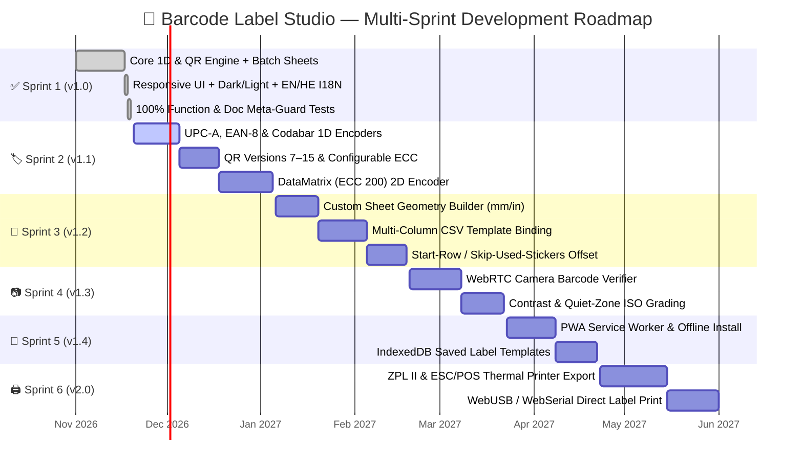
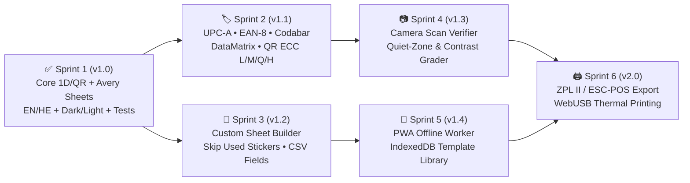

# 🗺️ Barcode Label Studio — Open-Source Engineering Roadmap (`ROADMAP.md`)

 

[-059669?style=for-the-badge)](CHANGELOG.md)

---

## 🎯 Roadmap Overview & Sprint Timeline

This roadmap translates the technical specification in **[`SPEC.md`](SPEC.md)** into self-contained, testable **engineering sprints** for continuous open-source development. Every sprint task is paired with an automated test requirement in [`tests/barcode.test.js`](tests/barcode.test.js).

---

## 🔗 Sprint Dependency Flow

---

## 📋 Detailed Sprint Backlogs & Actionable Tasks

### ✅ Sprint 1 — Foundation, Multi-Device UI, Bilingual I18N & 100% Test Gate (`v1.0.0` — Completed)

| Task ID | Component | Task Description | Verification / Test Gate | Status |
| :--- | :--- | :--- | :--- | :---: |
| `S1-T1` | 📊 **1D Encoders** | Implement `encodeCode128` (`128B`/`128C` auto-compaction), `encodeCode39`, `encodeEan13`, and `encodeItf`. | Unit tests for bit patterns, check digits, and invalid input fallbacks. | ✅ Done |
| `S1-T2` | 📱 **2D QR Engine** | Implement ISO/IEC 18004 `encodeQR` (Versions 1–6) with $\text{GF}(2^8)$ Reed-Solomon ECC and finder/alignment placement. | Unit tests for `gfMul`, `rsEncode`, `qrPlaceModules`, and `encodeQR`. | ✅ Done |
| `S1-T3` | 🖼️ **Logo & Text** | Support custom company logo upload (`<image>`) and top/bottom custom sticker text across Single and Batch modes. | Unit tests for XML entity escaping, 1D banner offset, and QR center badge. | ✅ Done |
| `S1-T4` | 🖨️ **Batch Sheets** | Implement 6 physical millimeter presets (`a4-3x8`, `a4-2x7`, `a4-4x10`, `letter-3x10`, `letter-2x7`, `flow`) + CSV/Excel import. | Unit tests for `STICKER_LAYOUTS`, `parseNumericSuffix`, and `parseFileAndAdd`. | ✅ Done |
| `S1-T5` | 🌐 **Bilingual & Theme** | Add English (`LTR`) / Hebrew (`RTL`) switcher (`setLanguage`) and Light / Dark mode switcher (`setTheme`) + mobile/tablet breakpoints. | Meta-guard checks 100% `data-i18n` key parity and responsive `@media` rules. | ✅ Done |
| `S1-T6` | 🛡️ **Meta-Guard** | Enforce 100% function export & unit test coverage gate + documentation link and SVG integrity checks in `npm test`. | 32+ automated tests in [`tests/barcode.test.js`](tests/barcode.test.js) running in CI. | ✅ Done |

---

### 🏷️ Sprint 2 — Expanded Retail, Industrial & 2D Symbologies (`v1.1.0`)

| Task ID | Component | Task Description | Acceptance Criteria & Test Gate | Status |
| :--- | :--- | :--- | :--- | :---: |
| `S2-T1` | 🛒 **UPC-A & EAN-8** | Add `encodeUpcA(text)` (11/12 digits) and `encodeEan8(text)` (7/8 digits) reusing GS1 Modulo 10 check-digit logic with one-click `fixValue`. | Export on `__BARCODE_API__`; test 95-module (UPC-A) and 67-module (EAN-8) outputs. | 🗓️ Planned |
| `S2-T2` | 🏥 **Codabar** | Add `encodeCodabar(text)` supporting numeric digits, `-$:/.+`, and `A/B/C/D` start/stop characters for blood banks and libraries. | Export `encodeCodabar` & `CODABAR_MAP`; add positive/negative unit tests. | 🗓️ Planned |
| `S2-T3` | 📱 **QR ECC Levels** | Extend `encodeQR(text, ecl)` to allow user-selectable Error Correction Levels (`L = 7%`, `M = 15%`, `Q = 25%`, `H = 30%`) — auto-boosting to `H` when a center logo is attached. | Verify format information bits and ECC codeword counts for all 4 levels. | 🗓️ Planned |
| `S2-T4` | 🔲 **DataMatrix** | Implement `encodeDataMatrix(text)` (ISO/IEC 16022 ECC 200 square symbol sizes $10\times10$ to $26\times26$) for small electronics and medical vials. | Verify L-shaped finder border, alternating timing border, and Reed-Solomon ECC. | 🗓️ Planned |

---

### 📐 Sprint 3 — Custom Label Sheet Designer & Partial Sheet Printing (`v1.2.0`)

| Task ID | Component | Task Description | Acceptance Criteria & Test Gate | Status |
| :--- | :--- | :--- | :--- | :---: |
| `S3-T1` | 📏 **Custom Sheet Grid** | Add a "Custom Dimensions" preset option allowing users to input custom Page Width/Height (`mm`), Columns, Rows, Label Width/Height, and Margins. | Validate `buildCustomLayout()` bounds and persist custom presets in `localStorage`. | 🗓️ Planned |
| `S3-T2` | ⏭️ **Skip Used Cells** | Add a `startCellOffset` (`Skip first N stickers`) control so partially used Avery sticker sheets can be reused without wasting labels. | Verify `refreshBatchSheet()` inserts $N$ empty `.sticker-cell.skipped` placeholders before the first barcode. | 🗓️ Planned |
| `S3-T3` | 🗂️ **Multi-Column CSV** | Support mapping CSV/Excel columns to `{barcodeValue}`, `{titleText}`, and `{subtitleText}` per individual sticker cell (e.g., SKU + Product Name + Bin Location). | Test multi-column CSV/XLSX rows rendering distinct titles per sticker cell. | 🗓️ Planned |
| `S3-T4` | 📦 **Standalone ZIP** | Bundle batch PNG exports into a single `.zip` download using a zero-dependency store-mode ZIP builder (`buildZipBlob()`). | Verify valid PKZIP local file headers and CRC-32 checksums in unit tests. | 🗓️ Planned |

---

### 📷 Sprint 4 — Built-In Camera Barcode Scanner & Optical Verifier (`v1.3.0`)

| Task ID | Component | Task Description | Acceptance Criteria & Test Gate | Status |
| :--- | :--- | :--- | :--- | :---: |
| `S4-T1` | 📷 **Camera Scan Tab** | Add an optional verification modal using the browser's `BarcodeDetector` API (with canvas scanline fallback for 1D bars) to test-scan generated labels via webcam/phone camera. | Test mock `BarcodeDetector` decoding and fallback 1D scanline binarization. | 🗓️ Planned |
| `S4-T2` | 🔍 **Quiet-Zone Guard** | Add an automatic ISO printability check warning if `quietZone` is set below $10\times$ the narrow bar width ($X$-dimension) or if a logo obscures finder patterns. | Unit test `checkBarcodePrintability()` warning thresholds across all symbologies. | 🗓️ Planned |

---

### 💾 Sprint 5 — Progressive Web App (PWA) & Template Library (`v1.4.0`)

| Task ID | Component | Task Description | Acceptance Criteria & Test Gate | Status |
| :--- | :--- | :--- | :--- | :---: |
| `S5-T1` | 📲 **Installable PWA** | Add `manifest.webmanifest` and an optional offline cache Service Worker (`sw.js`) so users can install Barcode Label Studio as a desktop/mobile app. | Validate `manifest.webmanifest` JSON schema, icons, and `display: "standalone"`. | 🗓️ Planned |
| `S5-T2` | 🗂️ **Saved Templates** | Allow saving named batch configurations (symbology + sheet preset + custom text + logo + payload list) to `localStorage` / `IndexedDB` with JSON export/import. | Unit test `exportProjectJson()` and `importProjectJson()` round-trip fidelity. | 🗓️ Planned |

---

### 🖨️ Sprint 6 — Direct Thermal Label Printer Output (`v2.0.0`)

| Task ID | Component | Task Description | Acceptance Criteria & Test Gate | Status |
| :--- | :--- | :--- | :--- | :---: |
| `S6-T1` | 🧾 **ZPL II Generator** | Implement `exportToZpl(values, options)` generating native Zebra Programming Language (`^XA ... ^BY ... ^BC / ^BQ ... ^XZ`) for Zebra industrial roll printers. | Unit test `exportToZpl()` output commands for Code 128 (`^BC`), Code 39 (`^B3`), EAN-13 (`^BE`), and QR (`^BQ`). | 🗓️ Planned |
| `S6-T2` | 🔌 **WebSerial / WebUSB** | Add optional direct browser-to-printer dispatch over `navigator.serial` / `navigator.usb` for one-click roll label printing without OS driver dialogs. | Test command framing and mock transport stream writing. | 🗓️ Planned |
