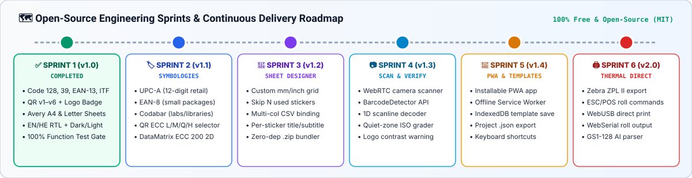
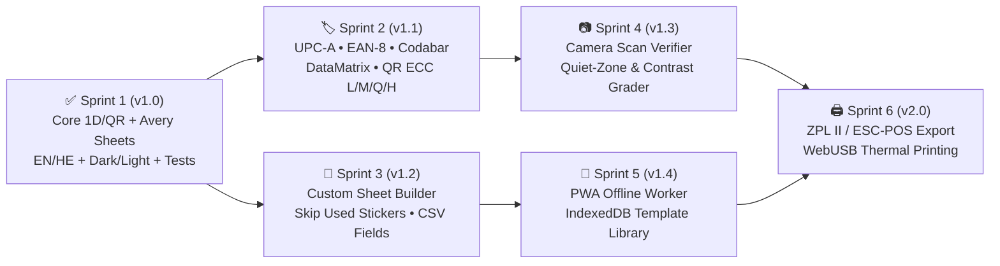
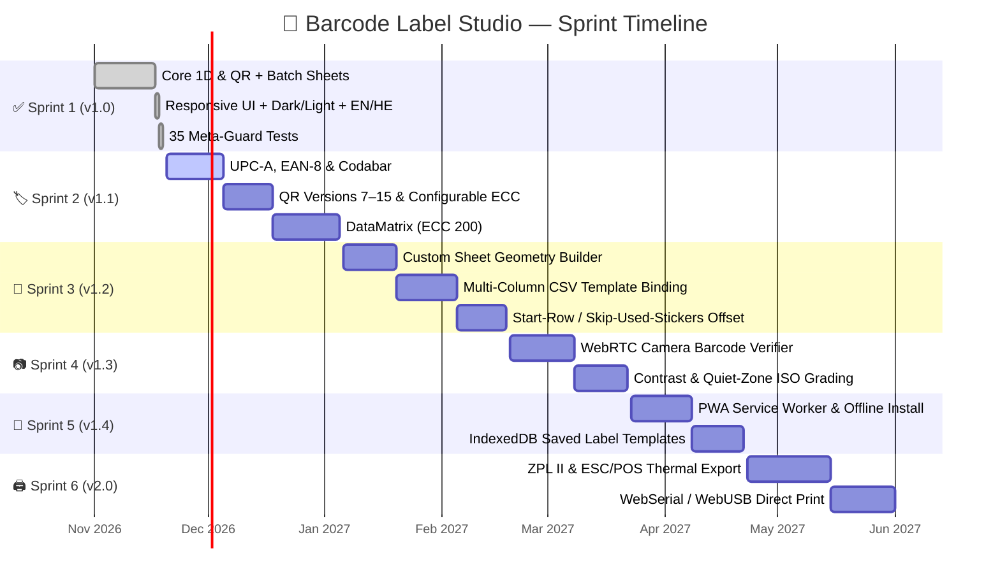

# 🗺️ Barcode Label Studio — Engineering Roadmap (`ROADMAP.md`)

 

[-059669?style=for-the-badge)](CHANGELOG.md)

---

## 🎯 Overview

This roadmap turns the [SPEC.md](SPEC.md) into testable engineering sprints. Every sprint task has an automated test gate in [tests/barcode.test.js](tests/barcode.test.js).

---

## ✅ Sprint 1 — Foundation, UI, I18N & Tests (`v1.0.0`)

| Task ID | Task | Verification | Status |
| :--- | :--- | :--- | :---: |
| S1-T1 | Implement Code 128 Auto, Code 39, EAN-13, ITF | Unit tests for bit patterns, check digits, fallbacks | ✅ Done |
| S1-T2 | Implement QR Code v1–v6 with Reed–Solomon ECC | Tests for `gfMul`, `rsEncode`, `qrPlaceModules`, `encodeQR` | ✅ Done |
| S1-T3 | Add logo upload and custom top/bottom text | XML escaping, banner offset, QR center badge | ✅ Done |
| S1-T4 | Batch sticker sheets + CSV/Excel import | `STICKER_LAYOUTS`, `parseNumericSuffix`, `parseFileAndAdd` | ✅ Done |
| S1-T5 | EN/HE switcher, Light/Dark themes, responsive breakpoints | 100% `data-i18n` parity, `@media` rules | ✅ Done |
| S1-T6 | Meta-guard test suite in CI | 35 automated tests in `tests/barcode.test.js` | ✅ Done |

---

## 🏷️ Sprint 2 — Expanded Symbologies (`v1.1.0`)

| Task ID | Task | Acceptance Criteria | Status |
| :--- | :--- | :--- | :---: |
| S2-T1 | UPC-A & EAN-8 encoders | Export on `__BARCODE_API__`; test 95/67-module outputs | 🗓️ Planned |
| S2-T2 | Codabar encoder | Export `encodeCodabar` & `CODABAR_MAP`; positive/negative tests | 🗓️ Planned |
| S2-T3 | User-selectable QR ECC levels L/M/Q/H | Verify format info bits and ECC counts for all levels | 🗓️ Planned |
| S2-T4 | DataMatrix ECC 200 (10×10 to 26×26) | Verify finder border, timing border, Reed–Solomon ECC | 🗓️ Planned |

---

## 📐 Sprint 3 — Custom Sheet Designer (`v1.2.0`)

| Task ID | Task | Acceptance Criteria | Status |
| :--- | :--- | :--- | :---: |
| S3-T1 | Custom mm/in sheet geometry builder | Validate `buildCustomLayout()` bounds; persist in `localStorage` | 🗓️ Planned |
| S3-T2 | Skip first N stickers control | `refreshBatchSheet()` inserts N skipped placeholders | 🗓️ Planned |
| S3-T3 | Multi-column CSV binding (value, title, subtitle) | Distinct titles per sticker cell | 🗓️ Planned |
| S3-T4 | Zero-dependency ZIP batch export | Valid PKZIP headers and CRC-32 tests | 🗓️ Planned |

---

## 📷 Sprint 4 — Camera Scan Verifier (`v1.3.0`)

| Task ID | Task | Acceptance Criteria | Status |
| :--- | :--- | :--- | :---: |
| S4-T1 | WebRTC camera scan tab | Mock `BarcodeDetector` and 1D scanline fallback tests | 🗓️ Planned |
| S4-T2 | Quiet-zone and contrast grader | `checkBarcodePrintability()` thresholds across symbologies | 🗓️ Planned |

---

## 💾 Sprint 5 — PWA & Template Library (`v1.4.0`)

| Task ID | Task | Acceptance Criteria | Status |
| :--- | :--- | :--- | :---: |
| S5-T1 | Installable PWA (`manifest.webmanifest`, `sw.js`) | Validate manifest schema and `display: standalone` | 🗓️ Planned |
| S5-T2 | Saved templates in `localStorage` / `IndexedDB` | Round-trip `exportProjectJson()` / `importProjectJson()` tests | 🗓️ Planned |

---

## 🖨️ Sprint 6 — Thermal Printer Output (`v2.0.0`)

| Task ID | Task | Acceptance Criteria | Status |
| :--- | :--- | :--- | :---: |
| S6-T1 | ZPL II generator (`^XA ... ^XZ`) | Test `^BC`, `^B3`, `^BE`, `^BQ` commands | 🗓️ Planned |
| S6-T2 | WebSerial / WebUSB direct print | Mock transport stream write tests | 🗓️ Planned |
