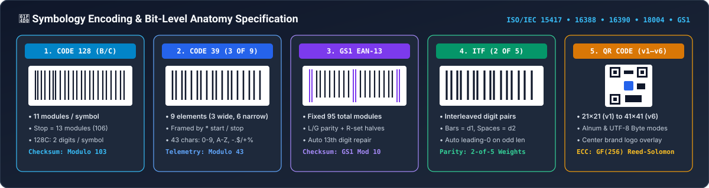
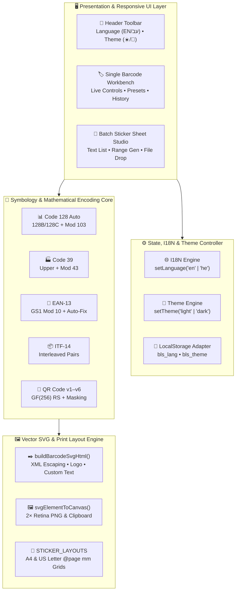
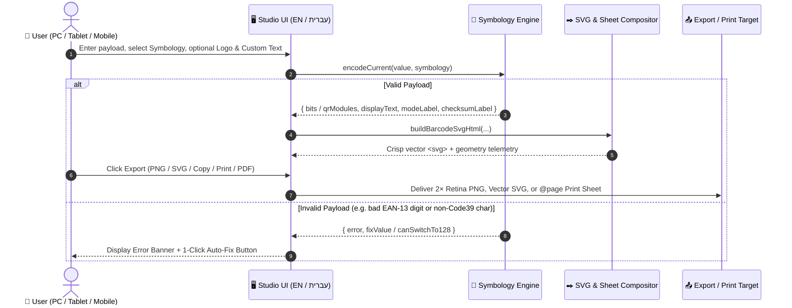

# 📐 Barcode Label Studio — Technical & Functional Specification (`SPEC.md`)

 

[_%2B_Hebrew_(RTL)-7c3aed?style=for-the-badge)](index.html)

---

## 🌟 1. Vision & Open-Source Charter

**Barcode Label Studio** is a **100% free, open-source (MIT License), zero-backend web application** for generating standards-compliant 1D and 2D barcodes and printing physical millimeter-accurate die-cut sticker sheets directly from any browser.

- 🔓 **Community & Open-Source First**: Permanently free and open-source with zero commercial tiers, zero watermarks, zero telemetry, and zero server dependencies.
- 💻 **Universal Device Support**: Responsive layout engineered for **Desktop PC (`> 1024px`)**, **Tablet (`641px – 1024px`)**, and **Mobile (`<= 640px`)**.
- 🌐 **Bilingual Localization**: Native **English (`en`, `LTR`)** and **Hebrew (`עברית`, `he`, `RTL`)** user interface with bidirectional isolation (`.ltr-code`) for serial numbers and barcode payloads.
- 🌓 **Adaptive Light & Dark Modes**: High-contrast studio themes (`data-theme="light"` / `data-theme="dark"`) while preserving optical-scanner-safe `#ffffff` sticker surfaces.

---

## 🧩 2. System Component Architecture

---

## 🔬 3. Symbology Encoding Specifications

### 📊 3.1 Code 128 Auto (`encodeCode128`) — ISO/IEC 15417
- **Character Domain**: Printable ASCII (`0x20`–`0x7E`, character codes `32`–`126`).
- **Pattern Table (`CODE128_PATTERNS`)**: `107` entries (`0`–`105` are `11`-module bar/space patterns; `106` is the `13`-module Stop pattern `1100011101011`).
- **Lookahead Compaction Rules**:
  1. Begins in **Code Set C** (`Start C = 105`) if the input starts with $\ge 4$ consecutive digits or is an exact 2-digit number; otherwise begins in **Code Set B** (`Start B = 104`).
  2. While in **Code Set C**, consumes digit pairs (`00`–`99` $\to$ symbol `0`–`99`) until fewer than 2 consecutive digits remain, then emits `Code B (100)`.
  3. While in **Code Set B**, switches to **Code Set C** via `Code C (99)` whenever $\ge 4$ consecutive digits are detected ahead.
- **Modulo 103 Checksum Formula**:

$$C_{128} = \left( \text{StartCode} + \sum_{i=1}^{n} i \cdot S_i \right) \bmod 103$$

### 🏭 3.2 Code 39 (`encodeCode39`) — ISO/IEC 16388
- **Character Domain**: `43` characters (`0–9`, `A–Z`, space, `-`, `.`, `$`, `/`, `+`, `%`) plus start/stop sentinel `*`.
- **Structure**: Each character is encoded as a `12`-module binary string (`5` bars and `4` spaces, with `3` wide elements of width `2` and `6` narrow elements of width `1`), separated by a `1`-module inter-character narrow space (`0`).
- **Telemetry Check Character**: Computes $\left(\sum_{i=1}^{n} \text{index}(c_i)\right) \bmod 43$.

### 🛒 3.3 EAN-13 (`encodeEan13` & `computeEan13CheckDigit`) — GS1 General Specification
- **Character Domain**: Exactly `12` or `13` numeric digits (`0–9`).
- **GS1 Modulo 10 Check Digit**:

$$d_{13} = \left( 10 - \left( \sum_{i=1}^{12} w_i \cdot d_i \bmod 10 \right) \right) \bmod 10, \quad w_i = \begin{cases} 1 & \text{if } i \text{ is odd} \\ 3 & \text{if } i \text{ is even} \end{cases}$$

- **Auto-Repair**: If a 13-digit input has an invalid $d_{13}$, returns `fixValue = base12 + expectedCheck` for one-click repair in the UI.
- **Bit Geometry**: `95` total modules = Start Guard (`101`, `3`) + Left 6 digits (`42` modules using `EAN_L`/`EAN_G` parity from `EAN_PARITY[d_1]`) + Center Guard (`01010`, `5`) + Right 6 digits (`42` modules using `EAN_R`) + End Guard (`101`, `3`).

### 📦 3.4 ITF / Interleaved 2 of 5 (`encodeItf`) — ISO/IEC 16390
- **Character Domain**: Numeric digits (`0–9`). Odd-length strings are automatically prefixed with `"0"` (`ITF (0-padded)`).
- **Encoding**: Pairs of digits $(d_1, d_2)$ are interleaved using `ITF_WEIGHTS` (`5` elements per digit, `2` wide `111`/`000` and `3` narrow `1`/`0`), framed by Start (`1010`) and Stop (`11101`).

### 📱 3.5 QR Code (`encodeQR`) — ISO/IEC 18004 Model 2 (Versions 1–6)
- **Supported Versions**: Version 1 ($21\times21$) through Version 6 ($41\times41$) at Error Correction Level **M** ($\approx 15\%$ recovery capacity).
- **Encoding Modes**: Automatic **Alphanumeric Mode (`0010`)** for `[0-9A-Z $%*+-./:]` and **Byte Mode (`0100`)** fallback for general ASCII/UTF-8 strings.
- **Galois Field $\text{GF}(2^8)$ Arithmetic (`gfMul`, `rsGeneratePoly`, `rsEncode`)**: Uses primitive polynomial $x^8 + x^4 + x^3 + x^2 + 1$ (`0x11D`) to generate Reed-Solomon parity codewords and interleave blocks (`qrInterleave`).

---

## 🔄 4. Interactive User Workflows (Sequence Diagram)

---

## 📱 5. Responsive Breakpoints, Theme Tokens & I18N Specification

| Viewport Tier | CSS Media Query | Single Mode Layout | Batch Source Panels | Touch & Control Adaptation |
| :--- | :--- | :--- | :--- | :--- |
| 🖥️ **Desktop / PC** | `> 1024px` | 2-column split (`1.05fr 1fr`, `960px` max) | 3-column grid (`1fr 1fr 1fr`) | Compact toolbar buttons, hover states |
| 📱 **Tablet** | `max-width: 1024px` | 1-column stack (`720px` max) | 2-column grid + full-width 3rd panel | Scrollable sheet preview container |
| 📲 **Mobile Phone** | `max-width: 640px` | 1-column stack (`100%` width) | 1-column stack (`100%` width) | `38px–42px` min touch height, 2×2 action grids |

---

## 🧪 6. Quality & Automated Verification Specification

All changes to code, configuration, SVG diagrams, and documentation are gated by [`tests/barcode.test.js`](tests/barcode.test.js):

1. 🛡️ **Meta-Guard Function Coverage Gate**: Parses [`index.html`](index.html) for every top-level `function` and verifies it is exported on `globalThis.__BARCODE_API__` and directly tested in [`tests/barcode.test.js`](tests/barcode.test.js).
2. 🌐 **Bilingual I18N Parity Gate**: Verifies `I18N.en` and `I18N.he` have identical keys and every `data-i18n*` attribute in [`index.html`](index.html) resolves in both languages.
3. 🚫 **Open-Source Non-Commercial Gate**: Verifies that documentation and specification files contain zero commercial/pricing/quote terms.
4. 🖼️ **SVG & Mermaid Integrity Gate**: Verifies all SVG files in `assets/` and Mermaid diagrams in documentation are well-formed and all local links exist.

---

## 🗺️ 7. Future Development Roadmap

All upcoming enhancements, symbologies, and print studio capabilities have been organized into actionable engineering sprints in **[`ROADMAP.md`](ROADMAP.md)**.
