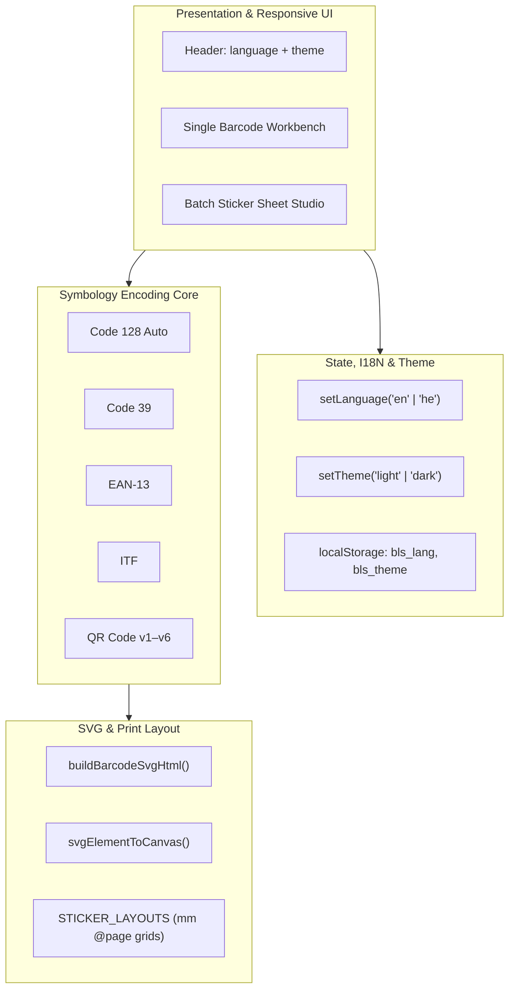
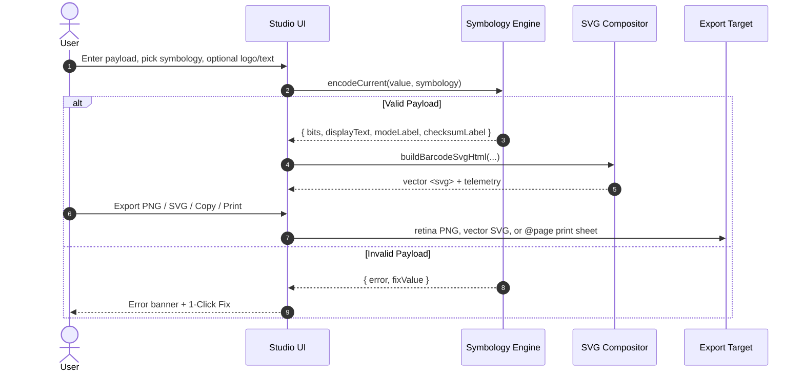

# 📐 Barcode Label Studio — Technical Specification (`SPEC.md`)

 

[_%2B_Hebrew_(RTL)-7c3aed?style=for-the-badge)](index.html)

---

## 1. Vision & Charter

Barcode Label Studio is a free, open-source (MIT), zero-backend web application for generating standards-compliant 1D and 2D barcodes and printing physical millimeter-accurate die-cut sticker sheets from any browser.

- 🔓 Open-source only: no commercial tiers, watermarks, telemetry, or backend dependencies.
- 💻 Responsive: desktop (`>1024px`), tablet (`641px–1024px`), mobile (`<=640px`).
- 🌐 Bilingual: English (`en`, LTR) and Hebrew (`he`, RTL).
- 🌓 Adaptive themes: `data-theme="light"` / `data-theme="dark"`, persisted in `localStorage`, with scanner-safe white sticker surfaces.

---

## 2. System Architecture

---

## 3. Symbology Specifications

### 3.1 Code 128 Auto (`encodeCode128`)

- **Standard**: ISO/IEC 15417
- **Character domain**: printable ASCII (`0x20`–`0x7E`)
- **Pattern table** (`CODE128_PATTERNS`): 107 entries. Entries `0`–`105` are 11-module bar/space patterns; entry `106` is the 13-module Stop pattern `1100011101011`.
- **Compaction rules**:
  1. Start in Code Set C (`Start C = 105`) if the input begins with ≥ 4 consecutive digits or is an exact 2-digit number; otherwise start in Code Set B (`Start B = 104`).
  2. In Code Set C, consume digit pairs (`00`–`99`) until < 2 consecutive digits remain, then emit `Code B (100)`.
  3. In Code Set B, switch to Code Set C via `Code C (99)` whenever ≥ 4 consecutive digits follow.
- **Checksum**: Mod 103 weighted sum

$$C_{128} = \left( \text{StartCode} + \sum_{i=1}^{n} i \cdot S_i \right) \bmod 103$$

### 3.2 Code 39 (`encodeCode39`)

- **Standard**: ISO/IEC 16388
- **Character domain**: `0–9`, `A–Z`, space, `- . $ / + %`, plus start/stop `*`.
- **Structure**: 12-module binary string per character (`5` bars + `4` spaces, `3` wide elements of width `2`, `6` narrow of width `1`), separated by a 1-module inter-character gap.
- **Check character**: `(∑ index(cᵢ)) mod 43`.

### 3.3 EAN-13 (`encodeEan13`)

- **Standard**: GS1 General Specification
- **Character domain**: exactly 12 or 13 digits
- **GS1 Mod 10 check digit**:

$$d_{13} = \left( 10 - \left( \sum_{i=1}^{12} w_i \cdot d_i \bmod 10 \right) \right) \bmod 10, \quad w_i = \begin{cases} 1 & i \text{ odd} \\ 3 & i \text{ even} \end{cases}$$

- **Auto-repair**: if the user enters 13 digits with a wrong `d₁₃`, `fixValue` returns the corrected payload.
- **Bit geometry**: `95` modules = Start guard `101` (3) + Left 6 digits (42) + Center guard `01010` (5) + Right 6 digits (42) + End guard `101` (3). Left-side parity (`EAN_L` / `EAN_G`) is selected from `EAN_PARITY[d₁]`.

### 3.4 ITF / Interleaved 2 of 5 (`encodeItf`)

- **Standard**: ISO/IEC 16390
- **Character domain**: numeric digits; odd-length inputs are prefixed with `0`.
- **Encoding**: digit pairs are interleaved using `ITF_WEIGHTS` (5 elements/digit, 2 wide + 3 narrow), framed by Start `1010` and Stop `11101`.

### 3.5 QR Code (`encodeQR`)

- **Standard**: ISO/IEC 18004 Model 2
- **Versions**: 1 (21×21) through 6 (41×41)
- **Error correction**: Level M (~15% recovery)
- **Modes**: Alphanumeric for `[0-9A-Z $%*+-./:]`; Byte mode for general ASCII/UTF-8.
- **Reed–Solomon**: GF(2⁸) with primitive polynomial `x⁸ + x⁴ + x³ + x² + 1` (`0x11D`), exposed via `gfMul`, `rsGeneratePoly`, and `rsEncode`.

---

## 4. Interactive Workflows

---

## 5. Responsive Breakpoints, Themes & I18N

| Viewport | Query | Layout |
| :--- | :--- | :--- |
| Desktop | `> 1024px` | 2-column split, 960 px max |
| Tablet | `max-width: 1024px` | 1-column stack, 720 px max |
| Mobile | `max-width: 640px` | Full-width stack, 38–42 px touch targets |

- Serial values and barcode payloads keep LTR direction via `.ltr-code`, regardless of UI language.
- Every `data-i18n` / `data-i18n-placeholder` key exists in both `I18N.en` and `I18N.he`.

---

## 6. Quality & Verification

All code, configuration, SVG, and documentation changes are gated by `tests/barcode.test.js`:

1. **Meta-Guard Function Coverage**: every top-level `function` in `index.html` is exported on `globalThis.__BARCODE_API__` and tested.
2. **Bilingual I18N Parity**: all `data-i18n*` attributes resolve in both languages.
3. **Open-Source Non-Commercial Gate**: docs contain no pricing, payment, or quote language.
4. **SVG, Mermaid & Link Integrity**: SVGs are well-formed with `<title>` / `<desc>`; Mermaid blocks are present; all local markdown links resolve.

---

## 7. Roadmap

See [ROADMAP.md](ROADMAP.md) for the sprint backlog: UPC-A, EAN-8, Codabar, DataMatrix, QR ECC levels, custom sheet builder, camera verifier, PWA, and thermal-printer export.
